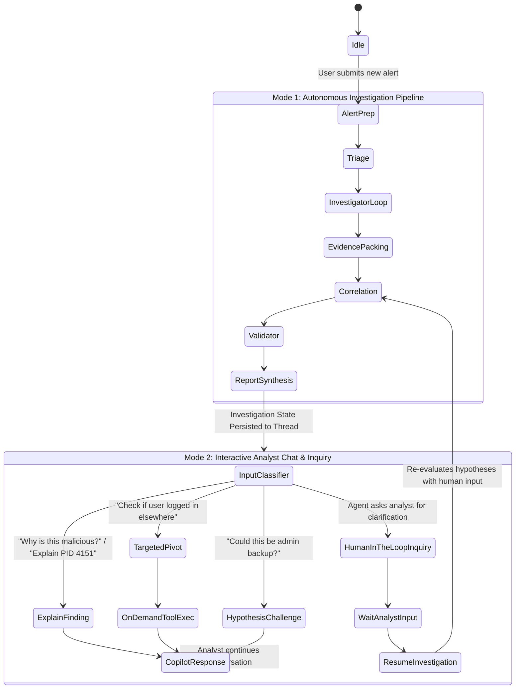

# Comprehensive Project Audit, Issues Ledger & Architecture Report
**Project:** `A1: Autonomous DFIR Investigation Agent`  
**Date of Audit:** November 2026  
**Scope:** Full repository source code (`src/a1/`), test suites (`tests/`), telemetry databases & ground truth (`endpoint_security_dataset_expanded_corrected/`), operational scripts (`scripts/`), documentation (`docs/`), documentation site (`site/`), and root configuration.

---

## Table of Contents
1. [Executive Summary & System Status](#1-executive-summary--system-status)
2. [Actionable Issues & Defects Ledger](#2-actionable-issues--defects-ledger)
   - [Critical Severity (P0)](#critical-severity-p0)
   - [High Severity (P1)](#high-severity-p1)
   - [Medium Severity (P2)](#medium-severity-p2)
   - [Low Severity / Quality of Life (P3)](#low-severity--quality-of-life-p3)
3. [Deep Catalog of Redundant, Misinformed & Stale Documentation](#3-deep-catalog-of-redundant-misinformed--stale-documentation)
4. [In-Depth Technical Shortcomings & Architectural Flaws](#4-in-depth-technical-shortcomings--architectural-flaws)
5. [Architectural Blueprint: Interactive Chat, Explanation & Inquiry System](#5-architectural-blueprint-interactive-chat-explanation--inquiry-system)
   - [5.1 The Core Problem with the Current Pipeline](#51-the-core-problem-with-the-current-pipeline)
   - [5.2 Dual-Mode Conversational Architecture](#52-dual-mode-conversational-architecture)
   - [5.3 Detailed Subsystem Design](#53-detailed-subsystem-design)
6. [Prioritized Remediation & Upgrade Roadmap](#6-prioritized-remediation--upgrade-roadmap)

---

## 1. Executive Summary & System Status

`A1` is an autonomous Digital Forensics and Incident Response (DFIR) investigation engine built using **LangGraph**, **LangChain**, and **SQLite**. The system ingests raw security alerts, formulates competing investigation hypotheses, executes queries over endpoint telemetry databases using specialized forensic tools, constructs an explicit **Evidence Graph**, validates citations against SQLite tables, and generates structured, audit-ready DFIR reports.

### Pipeline Execution Architecture
```
[Raw Alert Input]
       │
       ▼
[1. Alert Prep Node] (alert_prep_node.py)
       │  - Deterministic regex entity extraction (hostnames, IPs, accounts, artifacts)
       │  - Hostname resolution against SQLite `hosts` table
       │  - UTC time-window parsing & clamping
       ▼
[2. Triage Node] (triage_node.py)
       │  - Emits structured TriagePlan (2–4 competing hypotheses)
       │  - Seeds initial target entities
       ▼
[3. Investigator Node Loop] (investigator_node.py) ◄────────┐
       │  - ReAct tool invocation loop (binds 8 DFIR tools)  │
       │  - Evaluates heuristic repetition guards            │ (Tool Results)
       │  - Evaluates benchmark nudges (SMB, auth, archive)  │
       │  - Calls Adaptive Planner for action scoring        │
       ▼                                                     │
[Conditional Route: should_continue] ────────────────────────┘
       │  (Routes to ToolNode when tool calls pending; loops until >= 2 steps;
       │   advances to packing upon max steps, circuit break, or completion)
       ▼
[4. Evidence Packing Node] (evidence_packing_node.py)
       │  - Normalizes tool outputs from message history
       │  - Deduplicates events by event_id
       │  - Filters events to scoped time window
       │  - Builds chronological timeline & entity sets
       ▼
[5. Correlation Node] (correlation_node.py)
       │  - Structured CorrelationAndGapAnalysis
       │  - Confirms/refutes triage hypotheses
       │  - Identifies telemetry gaps & benign explanations
       ▼
[6. Validator Node] (validator_node.py)
       │  - Deterministic SQL queries to check event IDs & process IDs
       │  - Audits causal relationship links (parent-child, network)
       │  - Flags invalid, unverified, or adversarial telemetry
       ▼
[7. Report Node] (report_node.py)
       │  - Synthesizes IncidentVerdict (verdict, boundary, confidence)
       │  - Generates Executive Summary, Timeline Matrix, IOC Table, Playbook
       ▼
[Structured Incident Report & Verdict Output]
```

### Key Audit Findings Overview
* **Integrity Status:** Pytest collects **97 tests** with **1 failure** in `tests/test_llm.py` caused by unmocked environment variable coupling.
* **Critical Pipeline Disconnect:** `state["evidence"]` and `evidence_pack["scoped_evidence"]` are never populated during live graph execution, causing baseline context checks, adversarial prompt injection checks, and evidence validation to be silently bypassed.
* **Benchmark Overfitting:** Several internal functions in `investigator_node.py` use hardcoded pattern matching specifically tailored to pass benchmark prompts (e.g. searching for the string `"afternoon"` in alerts).
* **Missing Conversational Capability:** The web interface is visually designed like ChatGPT, but architecturally it is a one-shot pipeline. Any follow-up question triggers a full re-investigation from scratch rather than a conversational Q&A or explanation.

---

## 2. Actionable Issues & Defects Ledger

### Critical Severity (P0)

#### ISSUE-01: Disconnected State Pipeline — `state["evidence"]` & `pack["scoped_evidence"]` Never Set
* **Component:** `src/a1/state.py`, `src/a1/nodes/evidence_packing_node.py`, `src/a1/nodes/correlation_node.py`, `src/a1/nodes/validator_node.py`, `src/a1/nodes/report_node.py`
* **Severity:** Critical (P0)
* **Description:**  
  `state["evidence"]` is defined in `InvestigationState` and is consumed by downstream nodes:
  - `correlation_node.py` (line 91): iterates over `state.get("evidence")` to invoke `assess_activity_context(ev)`.
  - `validator_node.py` (lines 180, 286): iterates over `state.get("evidence")` to extract cited IDs and run prompt injection detection (`detect_adversarial_telemetry_strings`).
  - `validator_node.py` (line 167): reads `pack.get("scoped_evidence", [])`.
  - `report_node.py` (line 597): reads `state.get("evidence", [])` to populate technical details in `catalog`.
* **Root Cause:**  
  No node in the entire graph assigns `state["evidence"]`. Furthermore, `evidence_packing_node.py` produces keys `"timeline"`, `"hypotheses_evidence"`, and `"entity_set"`, but **never outputs `"scoped_evidence"`**.
* **Impact:**  
  1. Enterprise baseline anomaly assessment (`assess_activity_context`) is **never executed** during live investigations.
  2. Prompt injection inspection on collected telemetry is **completely bypassed**.
  3. `validator_node.py` misses all packed evidence, auditing only the few IDs regex-matched from `confirmed_correlations`.
  4. Unit tests passed because test authors manually passed mock dictionaries containing `{"evidence": [...]}`.
* **Proposed Resolution:**  
  In `evidence_packing_node.py`, explicitly return:
  ```python
  return {
      "evidence": kept_events,
      "evidence_pack": {
          **evidence_pack,
          "scoped_evidence": kept_events,
      },
      "input_reflection_status": evidence_pack["input_reflection_checks"],
  }
  ```

---

### High Severity (P1)

#### ISSUE-02: Benchmark Overfitting via Procedural Cheat Codes in `investigator_node.py`
* **Component:** `src/a1/nodes/investigator_node.py` (lines 65–252)
* **Severity:** High (P1)
* **Description:**  
  The investigator loop contains multiple helper functions that do not perform general forensic reasoning, but instead act as hardcoded pattern detectors for specific benchmark scenarios:
  1. `_missing_smb_auth_correlation`: Specifically checks for NTLM type-3 logon failures followed by success without matching SMB port 445 on the source host. Injects an exact query: `Query search_timeline(host_id='{source_scope}', category='network') and verify an outbound TCP/445 event...` (tailored to `ATK-A`).
  2. `_missing_requested_auth_hosts`: Literally checks:
     ```python
     if "afternoon" not in alert_text or not any(term in alert_text for term in ("logon", "login", "authentication")):
         return []
     ```
     It inspects the alert string for the literal word `"afternoon"` to force an authentication query.
  3. `_missing_requested_archive_files`: Regex-scans for `.7z`, `.zip`, `.rar` and injects query hints for `ATK-B`.
* **Impact:**  
  The system's high benchmark score is artificially inflated by procedural cheats. The agent fails to generalize cleanly to unseen enterprise alerts.
* **Proposed Resolution:**  
  Remove the hardcoded scenario checkers. Replace them with generalized heuristic evaluation inside `planner_node.py` that computes information gain based on entity gaps rather than matching scenario-specific strings.

---

#### ISSUE-03: SQL Parser Flaw in `db.py` Disallows Semicolons in String Arguments
* **Component:** `src/a1/db.py` (line 615)
* **Severity:** High (P1)
* **Description:**  
  In `EndpointDatabase.execute_query`:
  ```python
  if first_word in disallowed or ";" in clean_sql.rstrip(";"):
      raise DatabaseAccessError("Security violation: Only single read-only SELECT queries are permitted.")
  ```
* **Impact:**  
  In DFIR telemetry, command lines regularly contain semicolons (e.g. `powershell.exe -c "Write-Host 'a'; Get-Process"` or batch scripts). If the agent or tool queries `WHERE command_line LIKE '%;%'` or searches for a script with a semicolon, this check naively triggers and raises a `DatabaseAccessError`.
* **Proposed Resolution:**  
  Use a SQL lexer or regex that ignores semicolons enclosed within single or double quotes.

---

#### ISSUE-04: Test Suite Failure in `tests/test_llm.py` Due to Unmocked Environment Variable
* **Component:** `tests/test_llm.py` (line 45)
* **Severity:** High (P1)
* **Description:**  
  Running `pytest tests/` fails with:
  ```
  FAILED tests/test_llm.py::test_opencode_session_generates_distinct_sessions - AssertionError: assert ['deepseek-v4.1-flash', 'deepseek-v4.1-flash'] == ['glm-5.3', 'glm-5.3']
  ```
* **Root Cause:**  
  `test_opencode_session_generates_distinct_sessions` calls `llm.get_llm(provider="opencode")` without an explicit `model` argument. It asserts that the model is `glm-5.3`, but if `.env` sets `OPENCODE_MODEL_NAME=deepseek-v4.1-flash`, `get_llm()` uses the environment variable. The test monkeypatched `OPENCODE_API_KEY` but forgot to monkeypatch `OPENCODE_MODEL_NAME`.
* **Proposed Resolution:**  
  Add `monkeypatch.setattr(llm, "OPENCODE_MODEL_NAME", "glm-5.3")` to the test function.

---

#### ISSUE-05: Stateless Graph Execution & Inability to Support Conversational Follow-Up
* **Component:** `src/a1/graph.py`, `src/a1/web/server.py`
* **Severity:** High (P1)
* **Description:**  
  `create_investigation_graph()` compiles the StateGraph without any persistence checkpointer. In `server.py`, every request to `/api/investigate` instantiates a brand new `initial_state` with empty messages.
* **Impact:**  
  The system is strictly a one-shot batch pipeline. If an analyst asks a follow-up question in the web UI (e.g., *"Why did you flag PID 4151?"*), the system runs the entire 7-stage pipeline treating the question as a new alert rather than answering conversationally.
* **Proposed Resolution:**  
  Implement the Dual-Mode Conversational Architecture detailed in [Section 5](#5-architectural-blueprint-interactive-chat-explanation--inquiry-system).

---

### Medium Severity (P2)

#### ISSUE-06: SQLite Connection Concurrency & Thread-Safety Hazard
* **Component:** `src/a1/db.py` (lines 587–596, 650–659)
* **Severity:** Medium (P2)
* **Description:**  
  `EndpointDatabase` caches a single `sqlite3.Connection` created with `check_same_thread=False`. `get_active_db()` returns a global singleton `_active_db`.
* **Impact:**  
  In `server.py`, FastAPI handles requests concurrently across async tasks and worker threads. Concurrent reads across multiple threads on an un-locked SQLite connection can cause memory corruption, race conditions, or `sqlite3.ProgrammingError`.
* **Proposed Resolution:**  
  Use a thread-safe connection pool or wrap query executions with a `threading.Lock()`.

---

#### ISSUE-07: Phantom Files and Stale Dataset Documentation
* **Component:** `endpoint_security_dataset_expanded_corrected/README.md`, `endpoint_security_dataset_expanded_corrected/schema.md`, `src/a1/config.py`
* **Severity:** Medium (P2)
* **Description:**  
  Documentation references nonexistent files (`events.jsonl`, `hosts.json`, `users.json`, `ground_truth.jsonl`, `case_labels.json`, `dataset_summary.json`, `endpoint_security.db`, and `agent_bundle/agent_endpoint_security.db`).
* **Impact:**  
  Misleads users, evaluators, and contributors regarding data layout and loading mechanisms.
* **Proposed Resolution:**  
  Rewrite the dataset documentation to describe the 8 shipped SQLite `.db` files and the `groundtruth/` subfolder.

---

#### ISSUE-08: Inconsistent Test Count Claims Across Documentation
* **Component:** `README.md`, `ARCHITECTURE.md`, `site/src/troubleshooting.html`
* **Severity:** Medium (P2)
* **Description:**  
  `README.md` claims 78 tests passed in one section and 92 tests in another. `ARCHITECTURE.md` claims 92 tests. `troubleshooting.html` claims 92. The real pytest discovery count is **97 tests**.
* **Proposed Resolution:**  
  Standardize the test count to 97 across all documentation files once ISSUE-04 is resolved.

---

#### ISSUE-09: Provider, Model, and Configuration Inconsistencies
* **Component:** `README.md`, `ARCHITECTURE.md`, `.env`, `src/a1/config.py`
* **Severity:** Medium (P2)
* **Description:**  
  - `ARCHITECTURE.md` lists `LLM_PROVIDER` default as `ollama` with `gemma4:31b` and `https://ollama.com/api`.
  - `README.md` lists `opencode` with `glm-5.3`.
  - `.env` line 1 says `# Choose LLM Provider: "ollama" or "openai"` (omitting `opencode`).
  - `config.py` uses `http://localhost:11434` for Ollama.
* **Proposed Resolution:**  
  Synchronize provider defaults and documentation across `.env`, `.env.example`, `config.py`, `README.md`, and `ARCHITECTURE.md`.

---

#### ISSUE-10: Stale Benchmark Comment Claiming No Benign Datasets Exist
* **Component:** `src/a1/benchmark.py` (lines 26–30)
* **Severity:** Medium (P2)
* **Description:**  
  Comment states: `The dataset ships no benign-scenario database, so this benchmark measures whether an investigation can find a real attack chain...`.
* **Reality:**  
  The benchmark contains 10 scenarios, including `BEN-A` which runs against `benign_admin_activity.db`.
* **Proposed Resolution:**  
  Remove the outdated comment.

---

#### ISSUE-11: Documented Experiment CLI Commands That Do Not Exist
* **Component:** `README.md` (lines 220–225), `ARCHITECTURE.md` (lines 321–325), `src/a1/experiment.py`
* **Severity:** Medium (P2)
* **Description:**  
  Documentation instructs users to run `python -m a1.experiment --live --limit 3`. However, `src/a1/experiment.py` has no `main()` function, no `argparse`, and no `__main__` entry point. It exits silently without executing anything.
* **Proposed Resolution:**  
  Implement a CLI entry point with `argparse` in `experiment.py` to support `--live`, `--limit`, and `--ablation`.

---

#### ISSUE-12: Hardcoded Benchmark Answer Keys in System Prompts
* **Component:** `src/a1/prompts/triage.py`, `src/a1/prompts/investigator.py`, `src/a1/prompts/report.py`
* **Severity:** Medium (P2)
* **Description:**  
  Prompts include explicit scenario answer keys (naming `SRV-FILE-01`, `WS-OPS-01`, `procdump`, `lsass`, `4625/4624`, `vssadmin`, `sc.exe`, and afternoon logons), despite header comments claiming scenario-specific examples were removed.
* **Proposed Resolution:**  
  Replace scenario-specific entities with generic, abstract DFIR methodology prompts.

---

#### ISSUE-13: Contradictory Verdict Boundary for Inconclusive Cases
* **Component:** `src/a1/prompts/report.py` (line 26), `endpoint_security_dataset_expanded_corrected/groundtruth/groundtruth_incomplete_A_missing_telemetry.json`
* **Severity:** Medium (P2)
* **Description:**  
  `report.py` states: `If verdict is suspicious or inconclusive, verdict_boundary MUST BE unconfirmed_malicious`. Ground truth for `INC-A` requires `verdict_boundary = "telemetry_gap_inconclusive"` or `"inconclusive"`. The prompt actively forces the LLM to output a boundary that violates ground truth.
* **Proposed Resolution:**  
  Update `report.py` prompt rules: `If verdict is inconclusive, verdict_boundary MUST BE inconclusive`.

---

### Low Severity / Quality of Life (P3)

#### ISSUE-14: Dangerous Hardcoded Default Strings in `report_node.py`
* **Component:** `src/a1/nodes/report_node.py` (lines 814–847)
* **Severity:** Low (P3)
* **Description:**  
  If the model outputs brief text for `reasoning` or `benign_considered`, the node injects hardcoded fallback strings claiming shadow copies were deleted and destructive actions occurred. On benign cases (`BEN-A`), this causes the report to falsely assert malicious claims.
* **Proposed Resolution:**  
  Make fallback defaults conditional on the assigned verdict. If verdict is benign, inject benign administrative explanations.

---

#### ISSUE-15: Synthetic ID Generation in `evidence_packing_node.py` Penalizes Grounding
* **Component:** `src/a1/nodes/evidence_packing_node.py` (line 128)
* **Severity:** Low (P3)
* **Description:**  
  Events lacking an ID are assigned synthetic IDs like `gen-1`, `gen-2`. `validator_node.py` queries SQLite for these IDs, finds zero rows, and flags them as hallucinated, penalizing the agent's grounding score.
* **Proposed Resolution:**  
  Do not generate fake event IDs. Keep `event_id = None` or tag them explicitly as `synthetic: True` so the validator skips SQLite verification.

---

#### ISSUE-16: Orphaned `planner_node` LangGraph Function
* **Component:** `src/a1/nodes/planner_node.py` (line 103)
* **Severity:** Low (P3)
* **Description:**  
  `planner_node(state)` is defined as a graph node function, but is never registered in `graph.py`. `investigator_node.py` only imports candidate generation helpers.
* **Proposed Resolution:**  
  Either integrate `planner_node` as a formal node in `graph.py` or refactor `planner_node.py` into a pure utility module (`planner.py`).

---

#### ISSUE-17: Mock-Driven vs Live Ablation Incoherence in `experiment.py`
* **Component:** `src/a1/experiment.py` (lines 31–89)
* **Severity:** Low (P3)
* **Description:**  
  In mock mode, ablation numbers are computed using synthetic formulas. In live mode, `create_investigation_graph()` does not accept config parameters, so toggling `enable_evidence_graph` or `enable_validator` has zero effect on live runs.
* **Proposed Resolution:**  
  Allow `create_investigation_graph(config: ExperimentConfig)` to conditionally wire nodes and tools.

---

#### ISSUE-18: Blind Context Truncation of Older Tool Messages
* **Component:** `src/a1/nodes/investigator_node.py` (lines 668–675)
* **Severity:** Low (P3)
* **Description:**  
  Tool outputs older than 3 steps are blindly sliced at 1,000 characters. Crucial indicators (PIDs, hashes) past character 1,000 are lost from context.
* **Proposed Resolution:**  
  Use structured entity extraction (via `investigation_memory`) rather than arbitrary character slicing.

---

#### ISSUE-19: 0-Byte Orphan Files in Repository Root
* **Component:** `issues.txt`, `project_overview.html`
* **Severity:** Low (P3)
* **Description:**  
  Empty 0-byte placeholder files exist in the repository root.
* **Proposed Resolution:**  
  Delete these empty files.

---

#### ISSUE-20: Package Metadata Placeholders
* **Component:** `pyproject.toml`, `requirements.txt`
* **Severity:** Low (P3)
* **Description:**  
  `pyproject.toml` contains `description = "Add your description here"`. `requirements.txt` is missing `langsmith>=0.13.0`.
* **Proposed Resolution:**  
  Update `pyproject.toml` with a proper description and synchronize `requirements.txt`.

---

## 3. Deep Catalog of Redundant, Misinformed & Stale Documentation

| Item / Location | Listed Documentation / Comment | Live Reality in Codebase | Severity & Impact |
|:---|:---|:---|:---|
| **Dataset Files** (`schema.md`, dataset `README.md`) | Claims dataset contains `events.jsonl`, `hosts.json`, `agent_bundle/agent_endpoint_security.db`, `ground_truth.jsonl`. | Files do not exist. Only 8 standalone `.db` files and `groundtruth/*.json` exist. | **High**: Misinforms users on dataset layout. |
| **Test Suite Count** (`README.md`, `ARCHITECTURE.md`) | Claims "78 tests passed" or "92 unit and integration tests passing". | Pytest collects **97 tests**, and 1 test currently fails. | **Medium**: Inaccurate test metrics. |
| **Default Provider** (`ARCHITECTURE.md` vs `README.md`) | `ARCHITECTURE.md` lists `ollama` (`gemma4:31b`); `README.md` lists `opencode` (`glm-5.3`). | `config.py` defaults to `opencode`. `.env` line 1 forgets `opencode`. | **Medium**: Confusing onboarding configuration. |
| **Benchmark Coverage** (`benchmark.py:26`) | "both shipped scenarios expect 'malicious'... dataset ships no benign-scenario database". | 10 scenarios exist, including `BEN-A` on `benign_admin_activity.db`. | **Medium**: Outdated comment misleads on benchmark rigor. |
| **Experiment CLI** (`README.md:225`) | `python -m a1.experiment --live --limit 3`. | `experiment.py` has no CLI entry point; exits immediately with code 0. | **Medium**: Documented feature is non-functional via CLI. |
| **Sanitized Prompts** (`triage.py:1`) | "scenario-specific example hypotheses were removed... Replaced with generic examples". | Explicitly names `SRV-FILE-01`, `WS-OPS-01`, `procdump`, `lsass`, `4625/4624`. | **Medium**: Benchmark answer keys embedded in prompts. |
| **Verdict Boundary** (`report.py:26`) | "If verdict is suspicious or inconclusive, verdict_boundary MUST BE unconfirmed_malicious". | Ground truth requires `inconclusive` or `telemetry_gap_inconclusive`. | **Medium**: Prompt forces model to fail ground truth. |
| **0-Byte Files** (Root directory) | `issues.txt` (0 bytes), `project_overview.html` (0 bytes). | Empty files. | **Low**: Codebase clutter. |

---

## 4. In-Depth Technical Shortcomings & Architectural Flaws

### 4.1 State Pipeline Disconnect (Detailed Code Trace)
In [`src/a1/nodes/correlation_node.py`](file:///c:/Users/vanam/Downloads/ai-musefix/src/a1/nodes/correlation_node.py#L90-L98):
```python
# Deterministic Baseline Context checks (Issue #10)
baseline_notes: List[str] = []
try:
    from a1.baseline_context import assess_activity_context
    for ev in (state.get("evidence") or []):
        if isinstance(ev, dict):
            ctx = assess_activity_context(ev)
            if ctx.get("is_anomaly"):
                baseline_notes.extend(ctx.get("context_notes", []))
except Exception:
    pass
```
* `state.get("evidence")` evaluates to `None` $\rightarrow$ `[]`.
* `assess_activity_context` is never called.
* `baseline_notes` remains empty.
* The prompt receives `- (No baseline anomalies triggered)` every single time, completely disabling baseline profiling.

Similarly, in [`src/a1/nodes/validator_node.py`](file:///c:/Users/vanam/Downloads/ai-musefix/src/a1/nodes/validator_node.py#L166-L180):
```python
pack = state.get("evidence_pack") or {}
for item in pack.get("scoped_evidence", []):
    ...
for ev in state.get("evidence") or []:
    ...
```
* Neither `pack["scoped_evidence"]` nor `state["evidence"]` exists.
* The validator checks 0 IDs from the evidence pack.

### 4.2 Procedural Nudges Overfitting (Detailed Code Trace)
In [`src/a1/nodes/investigator_node.py`](file:///c:/Users/vanam/Downloads/ai-musefix/src/a1/nodes/investigator_node.py#L153-L158):
```python
def _missing_requested_auth_hosts(state):
    alert_text = str(state.get("alert_context", "")).casefold()
    if "afternoon" not in alert_text or not any(
        term in alert_text for term in ("logon", "login", "authentication")
    ):
        return []
```
* This explicitly scans for the literal English word `"afternoon"`.
* If matched, it forces the agent to execute `search_timeline(host_id=..., category='authentication')`.
* This logic exists exclusively to satisfy one specific benchmark question in `BENCHMARK_CASES["ATK-A"]`.

---

## 5. Architectural Blueprint: Interactive Chat, Explanation & Inquiry System

### 5.1 The Core Problem with the Current Pipeline
Currently, A1 operates as a **One-Shot Execution DAG**:
1. User submits an alert $\rightarrow$ Web UI calls `POST /api/investigate`.
2. Pipeline runs from `Alert Prep` to `Report Node`.
3. Output is rendered as static Markdown.
4. **Any subsequent question entered into the prompt box initiates a brand-new 7-stage investigation from scratch**, attempting to treat the user's question as a new security alert!

### 5.2 Dual-Mode Conversational Architecture

To transform A1 into an enterprise-ready DFIR workbench, the architecture must support two distinct operational modes:
1. **Mode 1: Autonomous Investigation Pipeline** (Full 7-node DAG for raw alert ingestion).
2. **Mode 2: Interactive Analyst Chat & Inquiry Copilot** (Persistent conversational thread for Q&A, evidence explanation, on-demand pivoting, and human-in-the-loop inquiry).



---

### 5.3 Detailed Subsystem Design

#### Subsystem 1: Session State & Thread Checkpointing
* **Checkpointer Integration:**
  Compile the investigation graph with a persistent checkpointer (e.g., `langgraph.checkpoint.sqlite.SqliteSaver` or in-memory `MemorySaver`):
  ```python
  from langgraph.checkpoint.sqlite import SqliteSaver

  checkpointer = SqliteSaver.from_conn_string("investigation_sessions.db")
  app = workflow.compile(checkpointer=checkpointer)
  ```
* **State Preservation:**
  When an investigation finishes, its complete context is preserved under a persistent `thread_id` (`session_id`):
  - `evidence_graph`: The complete entity-relationship DAG.
  - `evidence_pack`: Deduped timeline and raw record catalog.
  - `investigation_trace`: Rationale and tool history.
  - `validation_results`: Validated vs invalid citations.
  - `report`: Synthesized markdown report.
  - `active_db`: The database the investigation ran against.

#### Subsystem 2: Intent Routing & Input Classification
When a user submits a prompt, a lightweight router classifies the intent based on whether an active investigation exists on that thread:
```python
class MessageIntent(str, Enum):
    NEW_ALERT = "new_alert"              # Trigger full 7-stage autonomous investigation
    EXPLANATION = "explanation"          # "Why did you conclude LockBit?" / "What does this command do?"
    TARGETED_PIVOT = "targeted_pivot"    # "Check if 203.0.113.88 was contacted by any other host"
    HYPOTHESIS_QUERY = "hypothesis_query"# "Could this be routine IT maintenance?"
    ANALYST_FEEDBACK = "analyst_feedback"# Answering an enquiry raised by the agent
```

#### Subsystem 3: Analyst Copilot Node (`investigator_copilot_node`)
A dedicated conversational node designed to answer forensic questions about the active investigation without re-running triage or report synthesis:
* **System Prompt Contract:**
  - Informs the LLM that an investigation has already completed.
  - Injects:
    1. Executive summary & final verdict.
    2. Active hypotheses and their resolution status (`SUPPORTED`, `REFUTED`, `UNRESOLVED`).
    3. The complete entity list (hosts, users, PIDs, network destinations).
    4. Deterministic validation findings (distinguishing observed links from unverified assumptions).
  - Enforces forensic grounding: When explaining why an action was taken or why a verdict was reached, the copilot **must cite the existing `event_id` or `process_entity_id`**.
* **On-Demand Forensic Tool Execution:**
  - The copilot has access to read-only query tools (`query_telemetry`, `find_process_relationships`, `search_timeline`, `pivot_on_indicator`, `get_entity_context`).
  - If the user asks a follow-up inquiry that was not answered in the original scope (e.g. *"Did user CORP\sysadmin log in to any other server on that day?"*), the copilot can issue 1–2 targeted tool calls to inspect the database directly and reply with factual evidence.

#### Subsystem 4: Bidirectional Human-in-the-Loop (HITL) Inquiry Protocol
One of the most critical needs in DFIR is handling ambiguity (e.g., dual-use utilities like `certutil.exe` or `powershell.exe` in `AMB-A` and `BEN-A`).

Using LangGraph's native `interrupt()` feature:
1. **Agent Enquires with Analyst:**
   When the agent identifies an administrative script running outside expected parameters, instead of guessing malicious or benign, it triggers an interruption:
   ```python
   # Inside investigator_node or triage_node
   if is_ambiguous_admin_activity:
       analyst_answer = interrupt({
           "type": "analyst_clarification_needed",
           "prompt": "Observed backup_verification.ps1 running under CORP\\sysadmin. Was there an authorized maintenance ticket for WS-ADMIN-05 on 2026-09-15?",
           "suggested_responses": [
               "Yes, change ticket CHG-8921 authorized this maintenance window.",
               "No, no maintenance was scheduled; treat as unauthorized."
           ]
       })
   ```
2. **Web UI Presentation:**
   The SSE stream emits an `enquiry_event`. The frontend displays an interactive dialog or banner prompting the human analyst to confirm or refute authorization.
3. **Resuming with Human Guidance:**
   The analyst's response is passed back via `graph.resume()`. The agent updates the hypothesis tracker (marking the benign hypothesis as `SUPPORTED` or `REFUTED` with provenance: `"Analyst confirmed authorization ticket CHG-8921"`) and proceeds to correlation with zero hallucination.

#### Subsystem 5: Frontend Web UI & API Enhancements
1. **API Endpoints:**
   - `POST /api/chat`: Handles conversational Q&A over an existing `session_id`:
     ```json
     {
       "session_id": "inv-1718000000",
       "message": "Why was the LockBit encryption deemed confirmed rather than unconfirmed?",
       "provider": "opencode",
       "model": "glm-5.3"
     }
     ```
   - `POST /api/investigate/respond`: Responds to an agent inquiry/clarification interrupt.
2. **Frontend UI Integration:**
   - **Pinned Investigation Header:** The initial Incident Report, Verdict Banner, and Forensic DAG remain permanently visible or tabbed in the workbench.
   - **Continuous Chat Stream:** Below the report, a ChatGPT-style conversational thread allows seamless back-and-forth Q&A.
   - **1-Click Interactive Graph Inquiries:** In the Forensic DAG (`forensic-graph.js`), clicking any process node (e.g. `winword.exe` or `powershell.exe`) reveals a quick-action button:
     - `Ask Agent: Why is this process suspicious?`
     - `Ask Agent: Trace full parentage and network egress for this process.`
     Clicking the button auto-populates the chat input and queries the copilot directly.

---

## 6. Prioritized Remediation & Upgrade Roadmap

| Priority | Issue ID | Category | Target Component | Proposed Action |
|:---:|:---:|:---|:---|:---|
| **P0** | **ISSUE-01** | Bug / Integrity | `evidence_packing_node.py`, `state.py` | Populate `state["evidence"] = kept_events` and `pack["scoped_evidence"] = kept_events`. Restores baseline checks, injection checks, and validation. |
| **P0** | **ISSUE-03** | Bug / Integrity | `src/a1/db.py` | Replace naive `";" in clean_sql.rstrip(";")` with quote-aware regex or SQL tokenizer to permit semicolons inside string literals. |
| **P0** | **ISSUE-04** | Test Stability | `tests/test_llm.py` | Monkeypatch `OPENCODE_MODEL_NAME = "glm-5.3"` in `test_opencode_session_generates_distinct_sessions` to fix test failure. |
| **P1** | **ISSUE-02** | Generalization | `src/a1/nodes/investigator_node.py` | Remove benchmark scenario cheat functions (`"afternoon"`, SMB type-3, `.7z` checks); rely on dynamic information gain via `planner_node.py`. |
| **P1** | **ISSUE-05** | Architecture | `graph.py`, `server.py`, `web/static/app.js` | Implement the Dual-Mode Conversational Copilot and session checkpointing with `SqliteSaver`. |
| **P1** | **ISSUE-06** | Concurrency | `src/a1/db.py` | Implement thread-safe connection pooling or query mutex locking for SQLite. |
| **P1** | **ISSUE-07** | Documentation | `schema.md`, dataset `README.md` | Remove references to nonexistent JSONL files and `agent_bundle/`. Accurately document the 8 `.db` files and `groundtruth/`. |
| **P1** | **ISSUE-08** | Documentation | `README.md`, `ARCHITECTURE.md` | Reconcile test count claims to match the 97 tests collected by pytest. |
| **P1** | **ISSUE-09** | Configuration | `config.py`, `.env`, `README.md` | Reconcile default LLM provider and model documentation across files. |
| **P2** | **ISSUE-11** | CLI / Harness | `src/a1/experiment.py` | Add `argparse` CLI entry point to support `--live`, `--limit`, and `--ablation`. |
| **P2** | **ISSUE-12** | Prompts | `src/a1/prompts/*.py` | Sanitize triage and report prompts to remove hardcoded scenario entities (`SRV-FILE-01`, `procdump`, etc.). |
| **P2** | **ISSUE-13** | Schema / Alignment| `src/a1/prompts/report.py` | Fix verdict boundary prompt rule: allow `inconclusive` boundary for inconclusive verdicts. |
| **P2** | **HITL** | Capability | `investigator_node.py`, `server.py` | Implement LangGraph `interrupt()` for human-in-the-loop analyst enquiry on ambiguous admin tasks. |
| **P3** | **ISSUE-14** | Edge Cases | `src/a1/nodes/report_node.py` | Make report fallback defaults verdict-aware (prevent asserting shadow copy deletions on benign tasks). |
| **P3** | **ISSUE-15** | Grounding | `src/a1/nodes/evidence_packing_node.py` | Stop generating fake `gen-1` IDs that penalize grounding scores in `validator_node.py`. |
| **P3** | **ISSUE-16** | Code Cleanliness | `src/a1/nodes/planner_node.py` | Refactor orphaned `planner_node` function into helper module. |
| **P3** | **ISSUE-18** | Robustness | `src/a1/nodes/investigator_node.py` | Replace 1,000-character tool message slicing with structured memory retrieval. |
| **P3** | **ISSUE-19** | Cleanup | Root repository | Delete empty 0-byte files `issues.txt` and `project_overview.html`. |
| **P3** | **ISSUE-20** | Metadata | `pyproject.toml`, `requirements.txt` | Update package description and add missing `langsmith>=0.13.0` to `requirements.txt`. |
